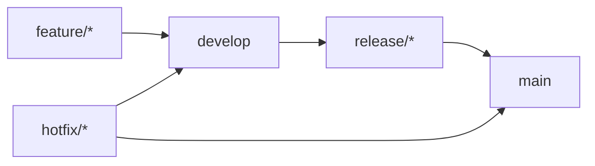

# Contributing Guidelines

Thank you for contributing to the **Express Delivery Eligibility** project! This document defines our branching model, coding standards, testing requirements, and pull request workflow.

---

## 1. GitFlow Branching Model

We strictly follow the **GitFlow** workflow to isolate development, pre-release testing, and production code:

- **`main`**: Production-ready branch. Every merge into `main` is tagged with a semantic version (`vX.Y.Z`) and automatically triggers the Docker release pipeline.
- **`develop`**: Main integration branch for ongoing development.
- **`feature/<feature-name>`**: Branched from `develop` for new features or refactoring (e.g., `feature/mlflow-tracking`). Merged back into `develop` via Pull Request.
- **`release/<version>`**: Branched from `develop` when preparing a production release (e.g., `release/v1.0.0`). Used for stabilization and integration testing before merging into `main` and `develop`.
- **`hotfix/<issue-name>`**: Branched from `main` to fix critical production bugs. Merged back into both `main` and `develop`.



---

## 2. Local Development Setup

```bash
python -m venv .venv
# Windows PowerShell:
.\.venv\Scripts\Activate.ps1
# Linux / macOS:
source .venv/bin/activate

python -m pip install -r requirements.txt
```

---

## 3. Code Quality & Architecture Rules

1. **Clean Architecture & SOLID**:
   - Keep business entities in `src/domain/`.
   - Never import concrete infrastructure adapters (`src/infra/local/` or `src/infra/database/`) directly inside `src/api/routers/` or `src/ml/`; always inject abstractions via `src/core/dependencies.py`.
2. **English Only**:
   - All code, comments, docstrings, commit messages, and documentation must be written in English.
3. **Linting & Formatting**:
   - Run Ruff and Pylint before committing:
     ```bash
     python -m ruff check .
     python -m pylint src/
     ```

---

## 4. Testing Requirements

Every new feature or bugfix must include corresponding tests under `tests/` (`etl`, `ml`, `infra`, or `api`).
Run the full test suite before opening a Pull Request:

```bash
python -m pytest -v
```

---

## 5. Pull Request Process

1. Create a branch from `develop` (`git checkout -b feature/your-feature develop`).
2. Commit your changes using clear, descriptive commit messages (`feat: ...`, `fix: ...`, `docs: ...`, `test: ...`, `chore: ...`).
3. Ensure `pytest`, `ruff`, and `pylint` pass locally.
4. Open a Pull Request targeting `develop` and wait for the GitHub Actions CI checks to pass before merging.
